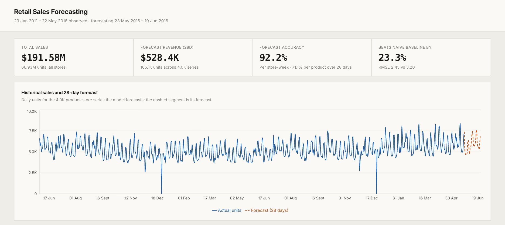
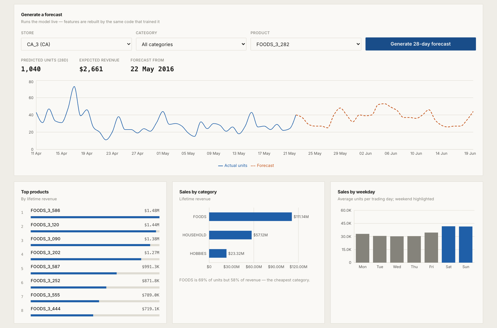
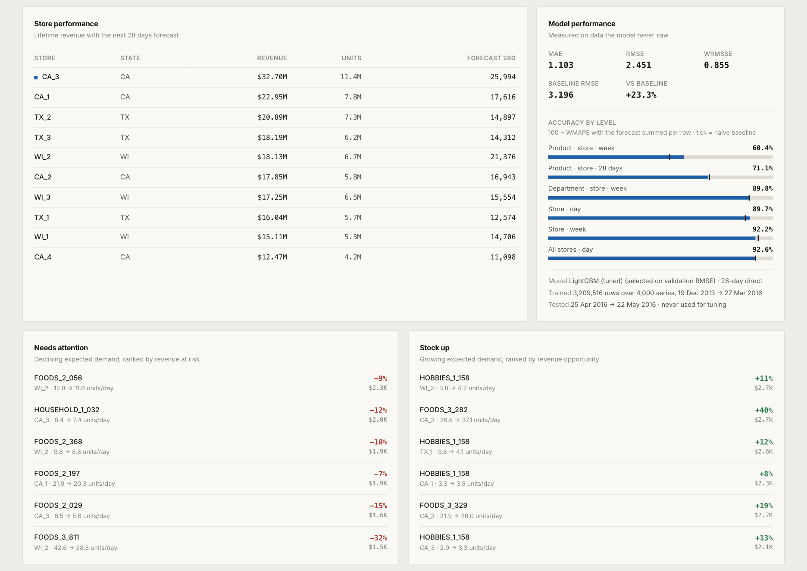

# Retail Sales Forecasting & Intelligence Dashboard

Forecasts how many units each product will sell in each store over the next **28 days**, and puts
that forecast, with the sales analytics behind it, on a dashboard for the people who decide what
to stock.

Built on the **M5 / Walmart** dataset: 3,049 products × 10 stores in 3 states (California, Texas,
Wisconsin), daily unit sales from 29 Jan 2011 to 22 May 2016: 1,941 days and 59M observations.



---

## Who it's for

| Who | What they use it for |
|---|---|
| **Buyers and replenishment planners** | A 28-day unit and revenue forecast for any product in any store, to size the next order. Two ranked lists, *Needs attention* (demand expected to fall) and *Stock up* (demand expected to rise), are ordered by the revenue at stake, so the biggest decisions come first. |
| **Category and merchandising managers** | Which categories bring units versus revenue, how much promotions and SNAP (food-assistance) days lift sales, and how strongly weekends drive demand. |
| **Store and regional managers** | Every store ranked by lifetime revenue alongside its own 28-day forecast. |
| **Data and analytics teams** | A worked example of a sales forecast that is honest about its accuracy: no future information leaks into training, and the dashboard's live forecasts are guaranteed to match the model that was evaluated. |

---

## What it finds

### About the business

* **Weekends drive demand.** Saturdays and Sundays average 41,580 units chain-wide against 31,753 on
  weekdays. That is **+30.9%**, the largest effect in the data.
* **Christmas is a closure, not a peak.** Stores are shut on 25 December (sales −100%). Thanksgiving
  (−38.9%) and New Year (−25.5%) are the next-biggest drops, and **November is the weakest month** of
  the year.
* **FOODS is 69% of units but 58% of revenue.** It is the highest-volume, lowest-price category.
* **CA_3 is the strongest store**: 11.4M units and $32.7M, 2.7× the units of the weakest (CA_4).
* **Demand is inelastic.** Within a product, a 1% price rise cuts units by about **0.64%**.
* **Promotions work unevenly.** On promotion, HOBBIES sells **+64%**, FOODS **+45%**, HOUSEHOLD only
  **+1.6%**.
* **SNAP days lift sales** by +7.5% in California, +11.1% in Texas and **+21.3% in Wisconsin**.

### About forecasting it

* **The model beats simple rules, consistently.** The shipped LightGBM model cuts RMSE by **23.3%**
  against the seasonal naive forecast ("same weekday, four weeks ago"), and beats it in **4 of 4**
  rolling backtests (21.0% on average). Its WRMSSE (the M5 competition's metric, where below 1.0
  means better than a naive forecast) is **0.855**, against 1.17 for both naive rules.
* **Product-by-day error is mostly chance.** A product that sells a few units a day sells one on some
  days and six on others, and no model can know which. So the dashboard reports accuracy at the
  levels decisions are made, scoring the same 28-day test window summed to each level:

  | Level (accuracy = 100 − WMAPE) | Model | Seasonal naive |
  |---|---|---|
  | Product · store · day | 26.4% | 9.0% |
  | Product · store · week | 60.4% | 54.1% |
  | Product · store · 28 days | 71.1% | 71.7% |
  | Department · store · week | 89.8% | 89.4% |
  | Store · day | 89.7% | 87.9% |
  | Store · week | **92.2%** | 93.6% |
  | All stores · day | 92.6% | 92.3% |

* **The model's value is at the product level.** Per product per week it scores 60.4% against the
  baseline's 54.1%, and per product per day 26.4% against 9.0%. At store and chain level it is level
  with the baseline, and per store-week slightly behind it (92.2% vs 93.6%). Small errors item by item
  can add up once everything is summed, so the high store-level numbers show how predictable the
  totals are, not how much the model adds there.
* **Leakage would have flattered the score by 11.8%.** Features like "yesterday's sales" don't exist
  when you forecast 28 days ahead. A model given them anyway scores RMSE 2.16 instead of 2.45, a
  number that could never be achieved in practice. The shipped model uses none of them.
* **Forecasting day by day doesn't escape that.** Predicting one day at a time and feeding each
  prediction back in (recursive forecasting) sees its error grow **37%** from day 1 to day 28. Over
  the full window it is mixed against the shipped direct model: lower RMSE (2.31 vs 2.45), but higher
  MAE and WMAPE.

---

## How it works

```
M5 CSVs ──► notebook ──► artifacts/ ──► FastAPI ──► React dashboard
            (analysis,    (model +       (forecasts,  (charts, tables,
             training,     serving data,  analytics,   live forecasts)
             evaluation)   summary tables) metrics)
```

1. **Explore.** The notebook (`retail_forecasting.ipynb`) loads the 59M daily observations and
   studies trends, seasonality, stores, prices, promotions, SNAP days and holidays.
2. **Build features that are knowable 28 days ahead.** Calendar, event, SNAP and price features, plus
   sales history lagged by at least 28 days (`lag_28` and rolling windows ending 28 days back). These
   live in one module, `forecasting/features.py`, used by both the notebook and the API.
3. **Split by time.** Train on the past, choose the model on a 28-day validation window, and score it
   once on the final 28 days (25 Apr to 22 May 2016), which no step of training or tuning ever sees.
4. **Compare models.** Two naive baselines, Linear Regression, Random Forest, XGBoost and LightGBM,
   then a 10-trial Optuna search on LightGBM. The model with the lowest validation RMSE ships:
   **tuned LightGBM**. Every run is logged to MLflow.
5. **Check it.** Four rolling-origin backtests, WRMSSE, error analysis, SHAP feature importance, and
   accuracy at each level (`forecasting/evaluation.py`).
6. **Guarantee train/serve parity.** Before saving the model, the notebook rebuilds the whole test
   window through the API's code path and asserts all 25 features match training exactly. If they
   differ, the notebook stops.
7. **Package and serve.** The notebook writes the model, the recent history it needs, a precomputed
   28-day forecast and summary tables to `artifacts/`. The FastAPI backend loads them once at start-up
   and serves forecasts and analytics. The React dashboard reads the API.

Modelling uses a stratified sample of **400 products × 10 stores = 4,000 series** to fit in about
4 GB of RAM. The dashboard's forecasts, charts and insight lists cover those 4,000 series. The sales
totals and category and store figures cover the whole chain.

---

## The dashboard

The overview (top of this page) shows lifetime revenue and units, the next 28 days of expected
revenue, accuracy per store-week with per-product accuracy over the 28-day window beneath it, and how
far the model beats the naive baseline. Its chart plots the 4,000 forecast series for two years,
running into the dashed 28-day forecast; the deep notches are the Christmas closures.



Pick a store and product and the model forecasts it live, rebuilding the features with the same code
that trained it. Below are the best sellers by revenue, the category split, and the weekday profile
with the weekend lift highlighted.



Every store with its 28-day forecast; the model's error metrics and accuracy by level, with the tick
on each bar marking the naive baseline; and the *Needs attention* and *Stock up* lists.

---

## Results

Scored once on the final 28 days (25 Apr to 22 May 2016), never used for training or model selection.

| Model | MAE | RMSE | WMAPE | WRMSSE | Notes |
|---|---|---|---|---|---|
| Naive (last value) | 1.439 | 3.123 | 96.0% | 1.170 | hold yesterday flat for 28 days |
| Seasonal naive (lag 28) | 1.363 | 3.196 | 91.0% | 1.172 | same weekday, four weeks ago |
| Linear Regression | 1.134 | 2.527 | 75.7% | 0.878 | one-hot + scaled, 1M-row subsample |
| Random Forest | 1.137 | 2.467 | 75.9% | 0.864 | 80 trees, depth 16 |
| XGBoost | 1.132 | 2.478 | 75.5% | 0.862 | `hist`, early-stopped |
| LightGBM | 1.106 | 2.450 | 73.8% | 0.857 | native categoricals |
| **LightGBM (tuned), shipped** | **1.103** | **2.451** | **73.6%** | **0.855** | 10-trial Optuna search; best on validation |

The model is chosen on validation RMSE only, so the test window stays untouched. Across four
rolling-origin backtests, RMSE is 2.53 ± 0.14 and the model beats the seasonal naive in every fold.
Metrics are saved in `artifacts/model_metadata.json` and in MLflow.

---

## Running it

### 1. Get the data

Download the [M5 competition data](https://www.kaggle.com/competitions/m5-forecasting-accuracy/data)
(you need a Kaggle account and must accept the competition rules), and put `calendar.csv`,
`sell_prices.csv` and `sales_train_evaluation.csv` in this folder. They are not in the repository.

### 2. Run the notebook

```bash
python -m venv .venv && .venv/Scripts/activate      # Linux/macOS: source .venv/bin/activate
pip install -r requirements.txt
jupyter lab retail_forecasting.ipynb
```

Run all cells. It takes roughly 25 minutes and runs on a machine with 8 GB of RAM. It writes
`artifacts/` (the model and its serving data) and `mlflow.db` (the experiment log).

> **Memory note.** The long-format panel is 59M rows. The notebook builds it in NumPy with explicit
> dtypes (~600 MB); the obvious `sales.melt(...)` raises `MemoryError` on an 8 GB machine. Modelling
> runs on a stratified 400-item sample. Raise `N_ITEMS_SAMPLE` and lower `FIRST_DAY` in §2 if you
> have more RAM.

### 3. Start the stack

```bash
docker compose up --build
```

| Service | URL |
|---|---|
| Dashboard | http://localhost:3000 |
| API docs | http://localhost:8000/docs |
| MLflow | http://localhost:5000 |

Optionally mirror the analytics tables into Postgres:

```bash
docker compose run --rm seed
```

### Without Docker

```bash
# API  (http://localhost:8000)
cd backend && uvicorn app.main:app --reload

# dashboard (http://localhost:5173, proxies /api to localhost:8000)
cd frontend && npm install && npm run dev
```

Both commands work as written on Windows, macOS and Linux. The API adds the repository root to
`sys.path` itself, so `forecasting` (the feature module it shares with the notebook) is importable
without a `PYTHONPATH` prefix. Running `uvicorn backend.app.main:app --reload` from the repository
root works too.

Point the dashboard at an API on another port with `VITE_API_TARGET=http://localhost:8010 npm run dev`.

Run the tests from the repository root:

```bash
pytest
```

---

## What's here

```
├── retail_forecasting.ipynb   the whole analysis: EDA → features → models → evaluation → packaging
├── forecasting/
│   ├── features.py            feature engineering shared by training AND serving
│   └── evaluation.py          accuracy at product, department, store and chain level
├── backend/                   FastAPI: forecasts, analytics, model metadata
├── frontend/                  React + Vite + TypeScript + Tailwind + Recharts dashboard
├── scripts/seed_postgres.py   mirror the analytics tables into Postgres
├── docker-compose.yml         dashboard + API + MLflow + Postgres
├── artifacts/                 model + serving data (generated by the notebook, not in git)
└── photos/                    dashboard screenshots used in this README
```

## API

| Method | Endpoint | Returns |
|---|---|---|
| `GET` | `/api/products` | items the model can forecast (`cat_id`, `search`, `limit`) |
| `GET` | `/api/stores` | stores with lifetime units, revenue and their 28-day forecast |
| `GET` | `/api/categories` | categories with unit and revenue shares |
| `GET` | `/api/sales/history` | daily units: chain-wide, only the forecast series (`scope=served`), or one series with `item_id`+`store_id` |
| `POST` | `/api/forecast` | live 28-day forecast for one series |
| `POST` | `/api/forecast/batch` | pre-computed forecasts for many series |
| `GET` | `/api/forecast/totals` | daily forecast totals across the forecast series |
| `GET` | `/api/metrics` | hold-out MAE / RMSE / WMAPE / WRMSSE, and accuracy by level |
| `GET` | `/api/model/info` | model type, training window, features, hyper-parameters |
| `GET` | `/api/analytics/overview` | dashboard KPIs |
| `GET` | `/api/analytics/top-products` | best sellers by revenue |
| `GET` | `/api/analytics/weekday` | average units by day of week |
| `GET` | `/api/insights/attention` | products with declining expected demand |
| `GET` | `/api/insights/restock` | products with growing expected demand |
| `GET` | `/health` | readiness, including whether the model loaded |

**Example**

```bash
curl -X POST http://localhost:8000/api/forecast \
  -H 'Content-Type: application/json' \
  -d '{"store_id": "CA_3", "item_id": "FOODS_3_282", "horizon": 28}'
```

```json
{
  "store_id": "CA_3",
  "item_id": "FOODS_3_282",
  "horizon": 28,
  "generated_from": "2016-05-22",
  "total_predicted_units": 1039.5,
  "total_expected_revenue": 2661.2,
  "forecast": [
    { "date": "2016-05-23", "predicted_sales": 37, "predicted_units_exact": 37.31,
      "sell_price": 2.56, "expected_revenue": 95.51 }
  ]
}
```

The API serves only the product-store series the model was trained on. `GET /api/products` is the
authoritative list; anything else returns `404` with an explanation rather than a made-up number.

## Notebook contents

| Part | Contents |
|---|---|
| 1 and 2 | Load, dtype strategy, wide→long reshape, weekly price table |
| **Part 1** | EDA: trends, seasonality, products, stores, prices, promotions, SNAP, events (16 charts) |
| **Part 2** | Calendar / event / price / lag / rolling features, and the leakage argument |
| **Part 3** | Chronological train / validation / test split on the M5's 28-day horizon |
| **Part 4** | Naive and seasonal-naive baselines; why raw MAPE is a trap when half the cells are zero |
| **Part 5** | Linear Regression → Random Forest → XGBoost → LightGBM |
| **Part 6** | Rolling-origin CV, WRMSSE, error analysis, Optuna, direct vs recursive, SHAP and partial dependence, MLflow, accuracy by level, packaging |
